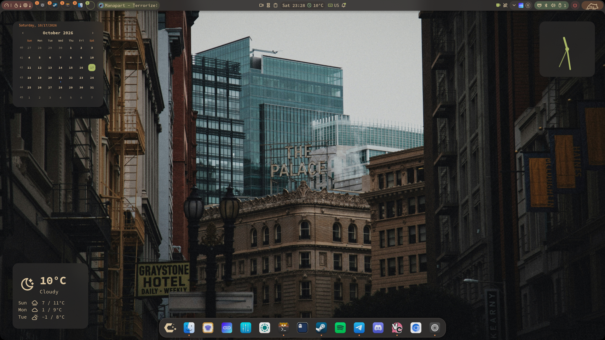
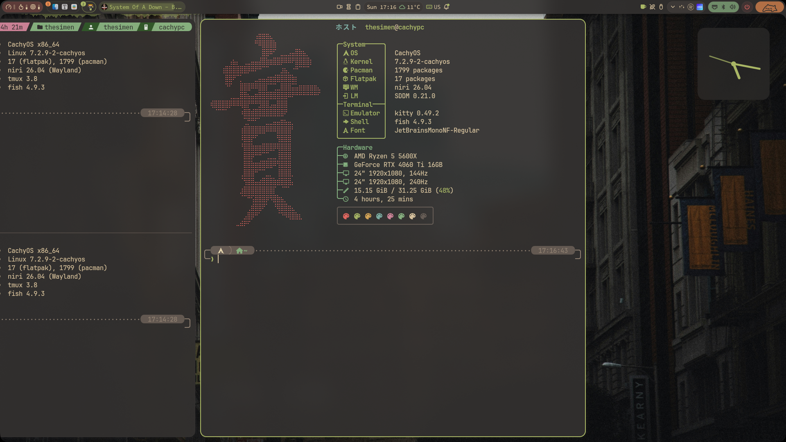
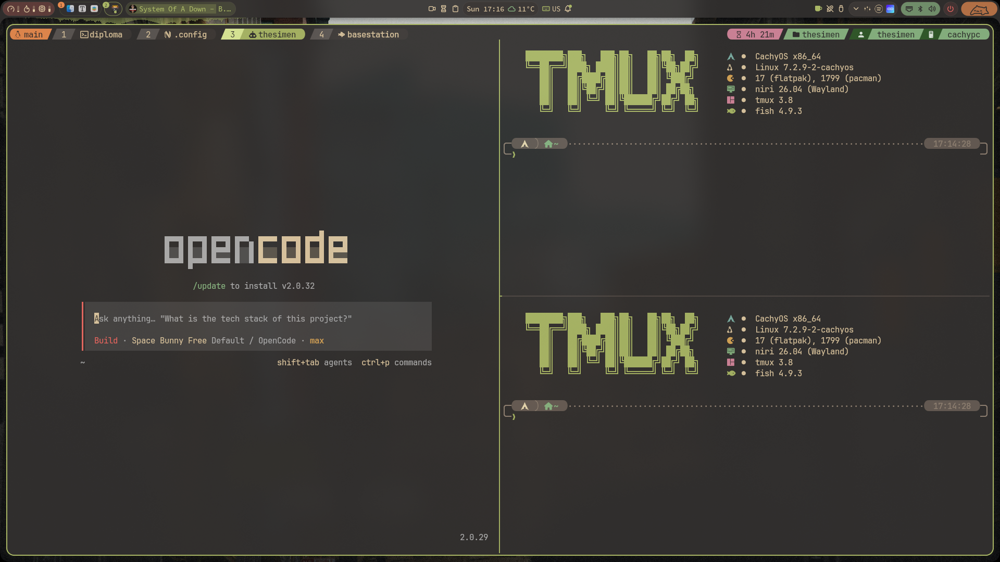
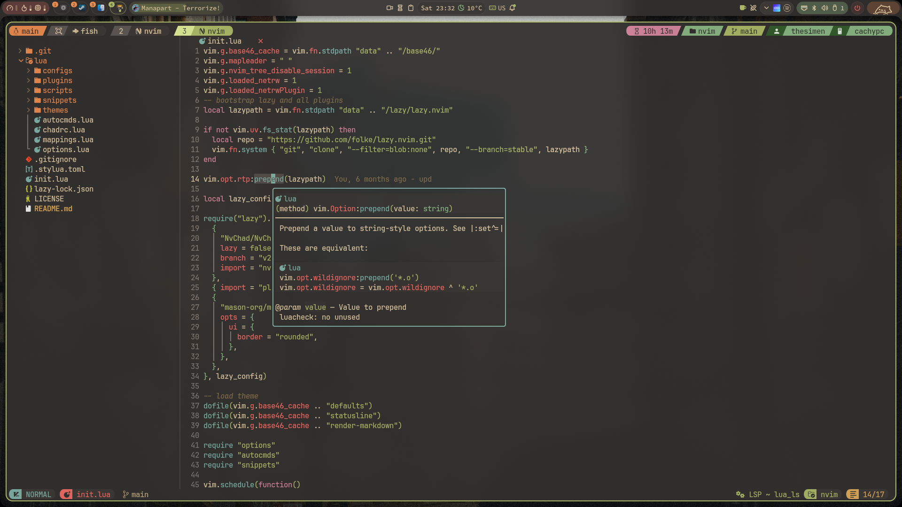
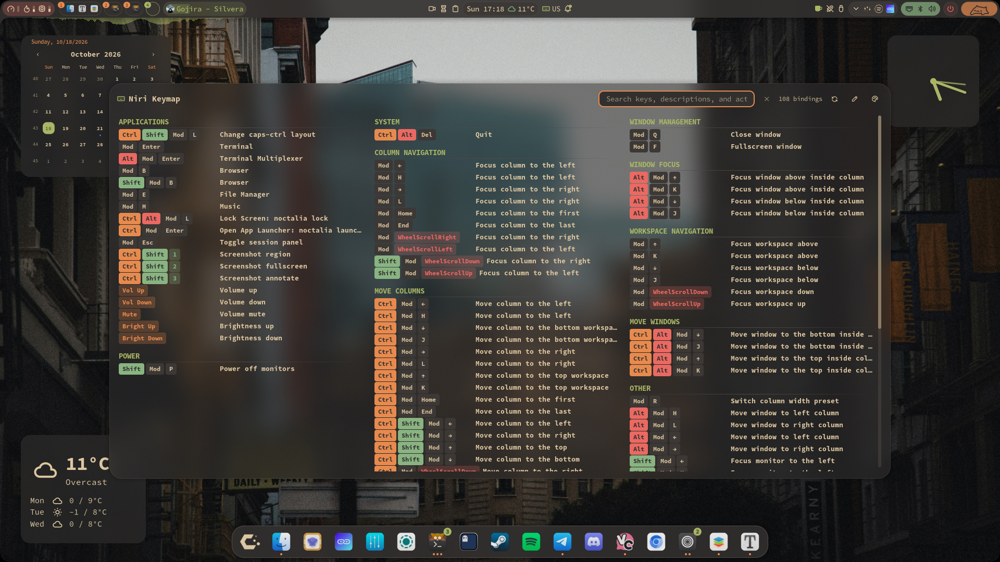
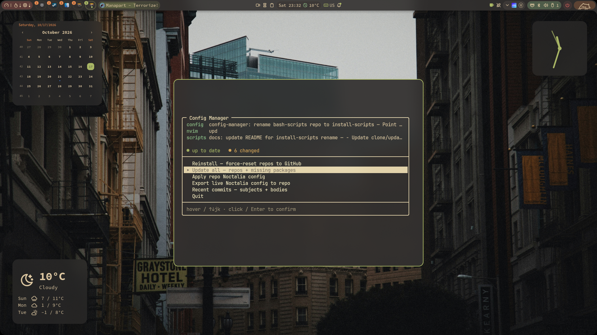

# Showcase

CachyOS + Niri + Noctalia, live Noctalia palette everywhere
(Gruvbox Material on the shots below).

[← back to README](README.md)

## Desktop

Noctalia desktop. Current theme is `gruvbox-material` from 
community palettes.

## Terminal

`kitty` + `fish` (`tide` prompt) + `fastfetch` with a custom logo.

`tmux` session with a matching status line and the same prompt 
with separated `fastfetch` output.

## Editor

Custom `NvChad` Neovim inside `tmux` — same palette, rounded borders.

## Keybindings

Built-in Niri keymap cheatsheet (noctalia plugin).

## Config manager

`config-manager` TUI: repo status for every config repo, update all,
apply/export the Noctalia config, browse recent commits and reinstall
back from GitHub.

---

Shot on:

| Component | Value                |
| --------- | -------------------- |
| OS        | CachyOS, 7.2.9-2-cachyos |
| Compositor| niri 26.04           |
| Shell     | Noctalia             |
| Terminal  | kitty 0.49.2         |
| Shell prompt | fish 4.9.3 + tide |
| Terminal Font      | JetBrainsMono Nerd Font |
| Font      | Hasklug Nerd Font |
